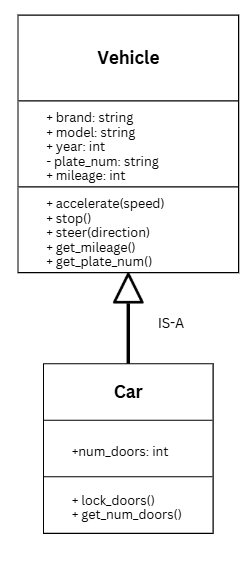
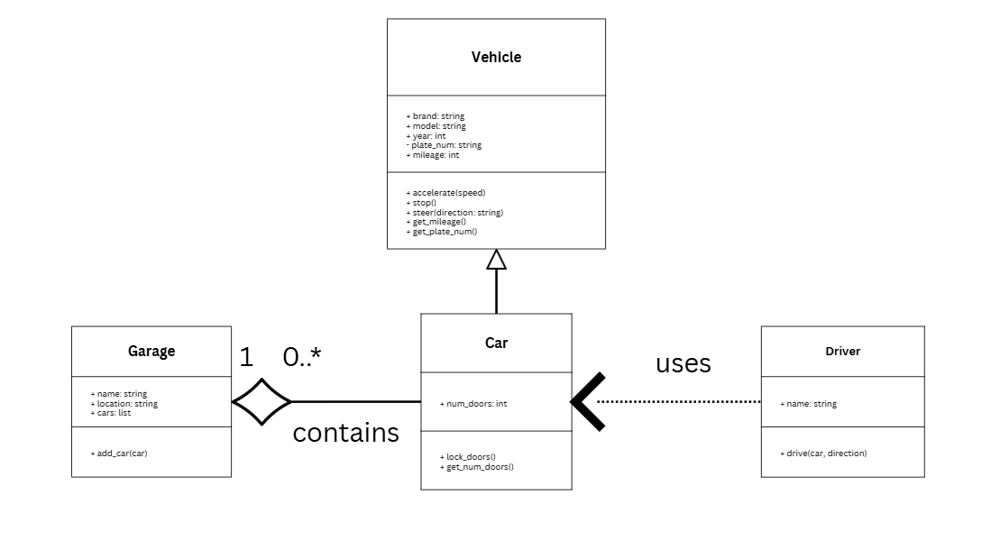
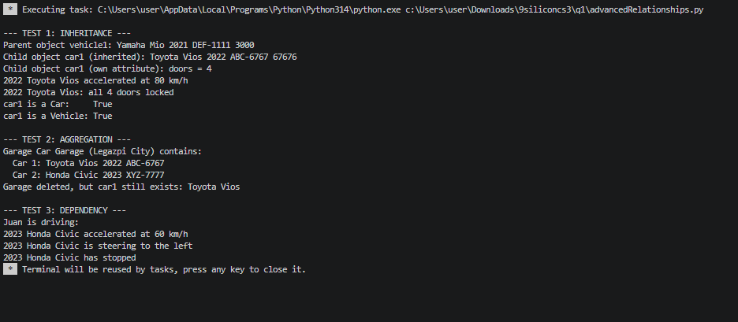
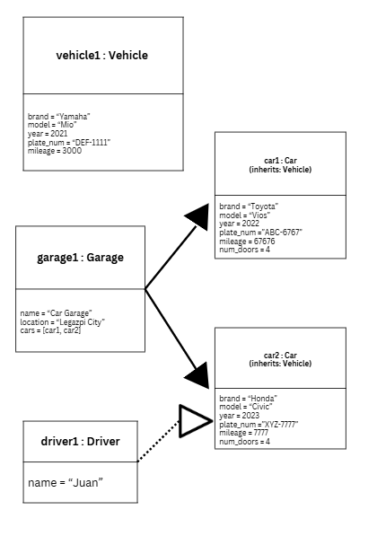

# Advanced Class Relationships
## Previous Activities
[classAttrib](classAttributesMethods.md)
[classRel](classRelationships.md)
## Existing System Description: My existing system has two classes, which are Car and Garage. The Car class represents a vehicle that has attributes like brand, model, year, plate number, and mileage, and methods like accelerate(), stop(), steer(), get_mileage(), and get_plate_num. The Garage class is a place where cars are stored and it could contain 0 or more cars. The limitations of this design is that the class Car have general information that can apply to any vehicle. Another type of vehicle needs all car attributes and methods copied in a new class, which causes repeated code.
## Inheritance Relationship
Parent: Vehicle   
Child: Car   
Explanation: The Car is a child of Vehicle because a car is a type of vehicle. The Car class can have its own additional attributes and methods because the Vehicle class contains attributes and methods that can be used by the Car class.
## Inheritance UML

## Composition/Aggregation
Relationship: Aggregation   
Explanation: I chose Aggregation as the relationship because the Cars are created first and received by the Garage through add_car(). If the Garage is deleted, the cars still exist independently. Also, i added optional dependency, which is Driver USES-A Car where the driver only uses Car temporarily inside drive() and does not own it.
## Advanced UML Diagram

## Python Implementation
[Source Code](advancedRelationships.py)
## Test Run

## Object Diagram

## Reflection
Answers:
1. I chose Vehicle as the parent and Car as the child because a car is a type of vehicle. A car has a brand, model, year, plate number, and mileage, just like any vehicle. It can also accelerate, stop, and steer. The only new thing a Car has is doors that can be locked. That is why Car IS-A Vehicle.
2. Car did not have to write the brand, model, year, plate_num, and mileage attributes again. It also did not have to write accelerate(), stop(), steer(), get_mileage(), and get_plate_num() again. All of these came from Vehicle. In my test, car1.accelerate(80) worked even though I only wrote accelerate() in Vehicle. Car only has its own num_doors, lock_doors(), and get_num_doors().
3. My relationship is Aggregation because the Garage holds Cars, but the Cars are made outside of the Garage. The Cars are given to the Garage using add_car(), so the Garage does not create them. If the Garage is deleted, the Cars still exist. In my test, car1 was still there after I deleted garage1. This means a Car can live without a Garage.
4. Association from Part III only shows that two classes are connected, like a Garage and its Cars. It does not say who owns what or what happens when one is deleted. Aggregation tells us that the Garage holds the Cars but the Cars can still exist by themselves. Inheritance is different because it shows that one class is a type of another class and uses its code. These new relationships explain my classes better than a simple association.
5. DRY means "Don't Repeat Yourself". My design follows this because the shared attributes and methods are only written once in Vehicle. Car uses them with inheritance and super().init() instead of copying them. If I want to change how accelerate() works, I only have to change it in one place. Then Car gets the change automatically.